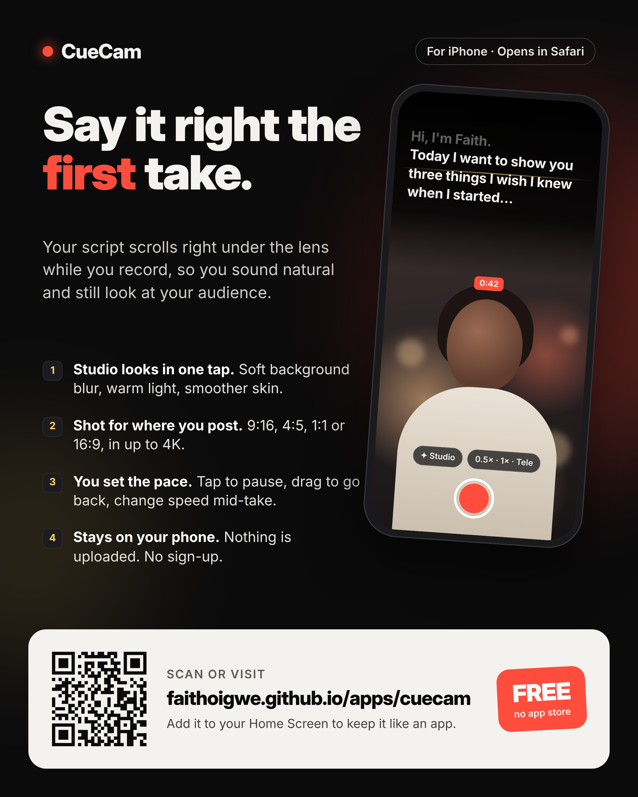

# Apps I'm working on

Small tools I build when I need something that doesn't exist yet, or only exists behind a paywall. They're free and they run in the browser, so nobody has to download anything.

| App | What it does | Try it |
| --- | --- | --- |
| [CueCam](cuecam/) | A teleprompter that sits on top of your phone camera | [faithoigwe.github.io/apps/cuecam](https://faithoigwe.github.io/apps/cuecam/) |

---

## CueCam

I film a lot of sit-down videos, and I kept running into the same problem. If I memorise the script I sound stiff, and if I read it off a laptop my eyes drift away from the camera. CueCam puts the script at the top of the screen, right under the lens, and scrolls it while you record.

**What you can do with it**

- Paste your script and see roughly how long it will take to say.
- Record with the front or back camera: 0.5×, 1× or Tele lens, 1080p or 4K, at 24, 30 or 60fps.
- Pick a look: Studio, Portrait, Bright & clean, Golden hour, Moody, Black & white or Natural. Each one sets the background blur, brightness, warmth and skin smoothing, and you can adjust any of them yourself.
- Beauty mode tracks your face: it smooths skin while keeping your eyes, brows and lips sharp, evens out skin tone and calms shine, and can slim the face, enlarge the eyes slightly and tint your lips. Each one has its own slider, and the Glam look turns them all on.
- Swipe left or right on the camera to change filters, the way you would on Snapchat: Glow, Blush, Peach, Clean girl, Honey, Dreamy, Y2K, Film and Sparkle (twinkles that stay behind you). A slider sets how strong each one is.
- Record in the shape you post in: full screen, 9:16, 4:5, 1:1 or 16:9.
- Tap the text to pause, drag it to go back, and change the speed or text size mid-take.
- Turn on a grid, a screen "ring light" for dark rooms, the flashlight, or zoom, and use the mic meter to check your voice is coming through.
- Save straight to Photos.

**Privacy.** Everything happens on your phone. Your script is saved in your browser and your videos never leave the device.

**How to use it.** Open the link in Safari on your iPhone and allow the camera and microphone. To keep it like an app, tap Share and then Add to Home Screen.

**Honest limits.** Apple doesn't let websites use the iPhone's Cinematic mode, Action mode or ProRes. Recording in the Camera app also stops anything playing on top of it, so a floating teleprompter over the Camera app doesn't work. That's why CueCam has its own camera and looks. Background blur runs on your phone, so it's softer than Cinematic mode and edges can be imperfect, especially around hair.

**Built with** plain HTML, CSS and JavaScript (one file), the browser camera and recording APIs, Google's MediaPipe Selfie Segmentation (background blur) and Face Mesh (beauty mode), both Apache 2.0 and kept in `cuecam/vendor`, plus a small WebGL shader for the skin, lips and face shape.
